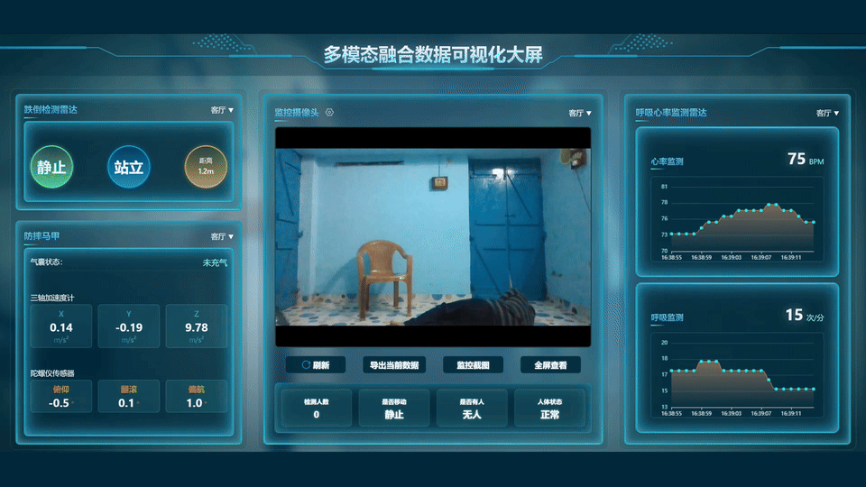

# 多模态融合数据可视化大屏 | CareFusion Dashboard

面向智慧养老场景的多模态数据可视化原型：将人体姿态视频、设备状态与趋势图表汇聚到一块大屏，探索跌倒监护和数字孪生场景的数据呈现方式。

> **项目状态：演示原型，尚非完整产品。** 多项 ECharts 数据、设备状态及告警由前端模拟，需要自行接入 API、传感器和硬件。当前 YOLO 视频链路用于人体检测与姿态展示，不能据此认定已经实现经过验证的跌倒识别或可靠报警。请勿用于实际医疗或安全监护。

## 界面预览



[观看 1080p 演示视频](demo/carefusion-demo-1080p25.mp4) · [查看完整截图](demo/dashboard-yolo.png)

演示展示模拟数据和 YOLO 人体姿态检测；视频为 1920×1080、25 fps，GIF 为 10 fps。视频使用 [GMDCSA-24](https://github.com/ekramalam/GMDCSA24-A-Dataset-for-Human-Fall-Detection-in-Videos) 的受控跌倒样例，仓库标注 MIT 许可，许可文本见 [GMDCSA24-LICENSE.txt](demo/GMDCSA24-LICENSE.txt)，数据集引用：Alam, E. (2024), GMDCSA24, [doi:10.5281/zenodo.12921216](https://doi.org/10.5281/zenodo.12921216)；画面并非真实老人跌倒。截图不代表系统具备经验证的自动跌倒告警能力。

## 功能概览

- 大屏展示跌倒检测雷达、摄像头及其他设备状态、趋势图表和告警状态。
- 使用 Vue 3、Vite、ECharts 和 DataV 构建可视化界面。
- 使用 FastAPI、OpenCV 和 Ultralytics YOLO 处理视频，通过 WebSocket 向大屏传输画面。
- 提供萤石云播放器集成入口；实际使用需要自行配置设备及服务。

## 架构

```text
摄像头 / 视频流 → OpenCV → YOLO 人体检测与姿态 → FastAPI WebSocket → Vue 大屏
传感器 / 业务 API ──────────────────────────────────────→ 待自行接入
```

## 项目结构

```text
info/          Vue 3 可视化前端
yolo-video/   Python 视频检测与 WebSocket 服务
```

## 本机启动（Windows PowerShell）

需要 Node.js、Python 环境以及可访问的视频源。下面的 `liangcang-yolo` 是本机已发现的 Conda 环境名称，其他机器请使用自己的环境；本仓库不包含模型权重，请从 Ultralytics 官方渠道获取 YOLO11n-pose 权重并放到 `yolo-video/yolo11n-pose.pt`，核查其许可；项目提供 `yolo-video/requirements.txt` 和 `environment.yml`，两者版本并不完全一致，安装时请核对 PyTorch、CUDA 与 Ultralytics 兼容性。

```powershell
# 终端 1：后端
conda activate liangcang-yolo
cd yolo-video
$env:RTSP_URL = 'rtsp://你的摄像头地址'
$env:MODEL_PATH = './yolo11n-pose.pt'
python main.py
```

```powershell
# 终端 2：前端
cd info
npm install
npm run dev
```

按 Vite 输出的本地地址访问页面，按 **N** 键进入数据演示模式；按 **D / A** 可手动切换严重 / 轻度跌倒告警，这些是模拟状态。前端当前连接 `ws://127.0.0.1:8000/ws/stream`，适合浏览器与后端运行在同一台机器。后端健康检查地址为 `http://127.0.0.1:8000/health`。当前服务默认监听所有网卡且未配置访问认证，请仅在可信网络中运行，勿直接暴露至公网。视频源、设备接入与网络配置需根据实际环境调整。

## 开源与使用说明

发布之前，请检查并移除项目中的设备地址、凭据、令牌和个人信息，轮换曾暴露的凭据；确认第三方模型、数据、视频和依赖的授权。项目代码目前未指定许可证，仅公开源码供查看；未经授权不能推定获得复制、修改或再分发的许可。第三方依赖、模型及素材遵循各自许可。

欢迎围绕可视化、智慧养老和多模态数据接入提出建议与交流。

