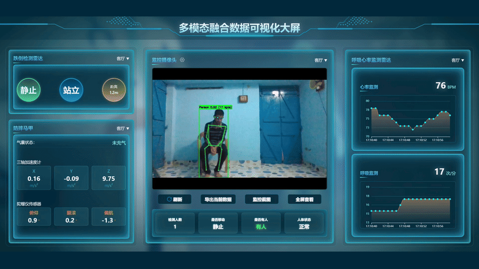
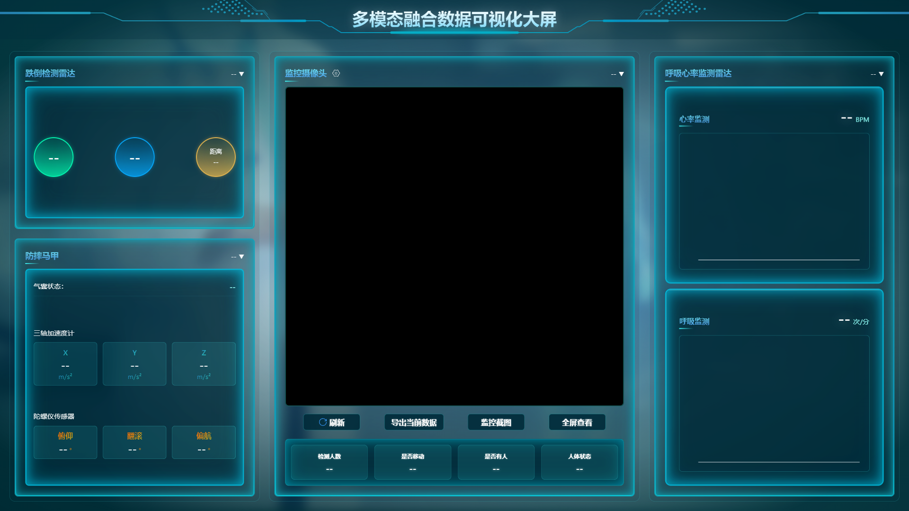
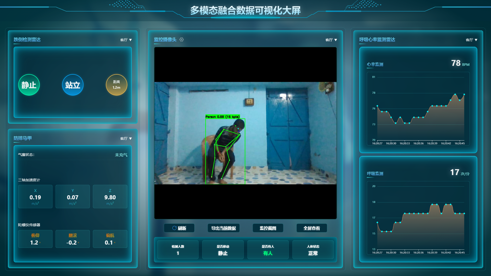
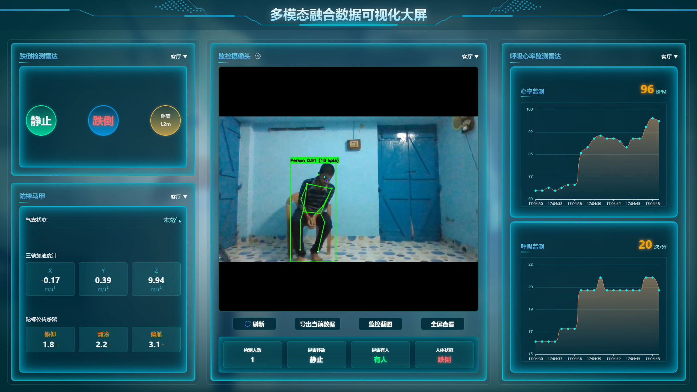
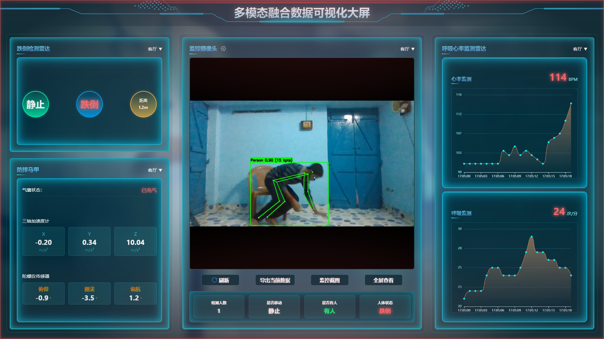

<div align="center">

# 老人跌倒多模态融合数据可视化大屏

### Elder Fall CareFusion Dashboard

**让视频、传感器与告警状态，在同一块智慧养老大屏中相遇。**

基于 Vue、ECharts、FastAPI 与 YOLO 姿态估计的多模态可视化演示原型。

[演示视频](#演示视频) · [项目截图](#项目截图) · [功能与架构](#功能与架构) · [快速开始](#快速开始) · [键盘操作](#键盘操作) · [项目状态与限制](#项目状态与限制)

</div>

> **请先了解：这是演示原型，不是自动跌倒检测系统。** 视频中的红色预警由操作人员按键手动触发；YOLO 用于人体检测与姿态展示，并不负责判断跌倒。设备状态、生命体征、图表和预警数据包含模拟内容，实际使用需要接入 API 或硬件。项目未经临床验证，请勿用于真实医疗或安全监护。

## 演示视频



[观看完整 1080p 视频](demo/fall-alarm-demo.mp4) · 视频 1920×1080、25 fps；GIF 为 960×540、10 fps。

演示中，在视频人物跌倒前提前按 **D**，经过约 2 秒延迟后显示红色预警。该操作用于同步展示，不代表系统自动识别跌倒。

## 项目截图

以下为完整页面截图；数值与预警状态均为演示数据。

### 无数据模式



### 数据展示模式



### 黄色预警：模拟轻度跌倒



### 红色预警：模拟严重跌倒



当前代码中未发现独立的橙色预警状态或按键；橙色雷达圆圈属于普通界面样式，因此此处不列作橙色告警截图。

## 功能与架构

- **多模态大屏**：集中展示雷达、监控、穿戴设备和生命体征图表。
- **姿态可视化**：OpenCV 接入视频流，YOLO 输出人体框和关键点，经 WebSocket 推送到前端。
- **场景演示**：通过键盘切换无数据、正常数据、轻度和严重跌倒预警等模拟状态。
- **扩展入口**：基于 Vue 3、Vite、ECharts、DataV 和 FastAPI，可自行接入真实设备及业务 API。

```text
摄像头 / 视频流 → OpenCV → YOLO 人体与姿态 → WebSocket → Vue 可视化大屏
传感器 / 业务 API ───────────────────────────→ 待自行接入
键盘操作 ───────────────────────────────────→ 模拟数据与预警状态
```

## 快速开始

前端需要 Node.js；后端需要 Python、PyTorch、OpenCV、FastAPI 和 Ultralytics，以及可访问的视频源。`yolo-video/requirements.txt` 与 `environment.yml` 的版本不完全一致，请根据系统和 CUDA 环境核对。模型权重不包含在仓库中，请从 Ultralytics 官方渠道获取 `yolo11n-pose.pt` 并放入 `yolo-video/`，同时核查其许可证。

```powershell
git clone https://github.com/Xie-Fantasy/CareFusion-Dashboard.git
cd CareFusion-Dashboard
```

在两个终端分别启动：

```powershell
# 终端 1：后端；替换为自己的 Conda 环境及视频源
conda activate <你的环境名称>
cd yolo-video
$env:RTSP_URL = 'rtsp://你的摄像头地址'
$env:MODEL_PATH = './yolo11n-pose.pt'
python main.py
```

```powershell
# 终端 2：前端
cd info
npm install
npm run dev
```

打开 Vite 输出的本地地址并按 **N**。前端连接 `ws://127.0.0.1:8000/ws/stream`，适合浏览器与后端在同一台机器运行；健康检查为 `http://127.0.0.1:8000/health`。

## 键盘操作

| 按键 | 演示行为 |
| --- | --- |
| N | 从无数据模式进入数据模式并连接视频，约 2 秒后生效 |
| A | 切换模拟轻度跌倒（黄色预警），约 2 秒后生效 |
| D | 切换模拟严重跌倒（红色预警），约 2 秒后生效 |
| V | 切换模拟体动状态 |
| M | 模拟网络断开或恢复 |

A 和 D 是手动切换，不由视频检测结果触发。视频推理速度取决于设备；YOLO 可能漏检遮挡或画面边缘的人体。

## 项目结构

```text
info/          Vue 可视化前端
yolo-video/    Python 视频检测与 WebSocket 服务
demo/          界面截图、演示视频与素材许可
```

## 项目状态与限制

本项目尚非完整产品。图表、设备状态和预警包含模拟数据；真实雷达、穿戴设备、告警、数据存储及业务服务需要自行开发和接入。后端当前监听所有网卡且未配置访问认证，请仅在可信网络运行，勿直接暴露至公网。

项目代码目前未指定许可证，仅公开源码供查看；第三方模型、依赖和素材遵循各自许可。请勿将摄像头地址、设备密码或令牌提交到公开仓库。

演示视频采用 [GMDCSA-24](https://github.com/ekramalam/GMDCSA24-A-Dataset-for-Human-Fall-Detection-in-Videos) 的受控跌倒样例，拍摄对象不是经确认的真实老人跌倒事件。素材仓库标注 MIT 许可，许可文本见 [GMDCSA24-LICENSE.txt](demo/GMDCSA24-LICENSE.txt)。数据集引用：Alam, E. (2024), GMDCSA24, [doi:10.5281/zenodo.12921216](https://doi.org/10.5281/zenodo.12921216)。

欢迎围绕可视化、智慧养老与多模态数据接入提出建议和交流。
